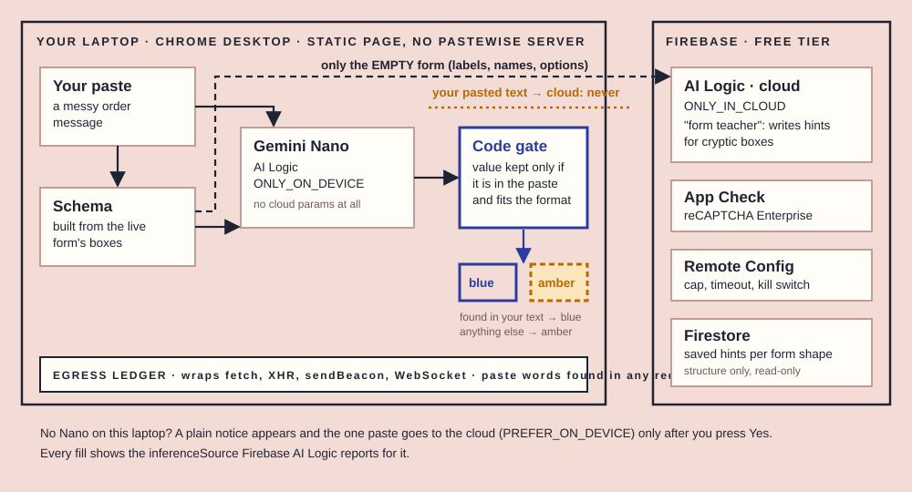

<div align="center">
  
  <h1>Pastewise ✍️</h1>
  <p><em>Copy a messy order message, press one shortcut, and the form's fields fill on your laptop.</em></p>
  

  <br/>

  [](https://pastewise.edycu.dev)
  [](https://pastewise.edycu.dev/receipt/)
  [](https://pastewise.edycu.dev/bench/)
  [](https://firebasehybridaihackathon.devpost.com/)

  <br/>

  
  
  
  
  [](LICENSE)

</div>

---

> **Judges: 30-second path.** Open the [live page](https://pastewise.edycu.dev), pick a sample message, press **Fill**. On a Chrome desktop with
> Gemini Nano you will see `ON_DEVICE` on every fill. Without Nano you get a plain notice and are asked before that one paste goes to the cloud.
> The [receipt page](https://pastewise.edycu.dev/receipt/) shows the recorded network log behind the "0 bytes" counter.

## 📸 See it in Action

<p align="center"></p>

1. Copy an order message from a chat. Paste it on the white **top sheet**.
2. Gemini Nano, through Firebase AI Logic, proposes a value for each box on the pink **copy**.
3. Plain code decides. A value is kept (carbon blue, with its source words underlined in your text) **only if it appears in your text and fits the box's format**. Anything else stays **amber**, with the reason in words ("two numbers in your text, pick one").
4. A counter reads how many words from your paste were found in any network request. On the recorded run: **0**.

Pastewise never presses Submit. You always see the form before it goes anywhere.

## 💡 The Problem & Solution

### The Problem
People who take orders in chat re-type each message into a courier portal, a booking form or a stock sheet. Browser autofill fills your *saved profile*. It does not read the message you just copied, which holds someone else's name, phone number and address. Sending that message to a cloud model to read it means sending a customer's private details to a third party.

### The Solution
The message is read by the model on the laptop. The model is not trusted: a value is accepted by **code**, not by a model's "confidence". The cloud is used for what it is better at and what carries no customer data: it sees only the **empty form** (labels, names, options) and writes hints for cryptic boxes such as "CNEE" or "form teacher".

## 🏗️ Architecture & Tech Stack

<p align="center"></p>

| Layer | Choice |
|---|---|
| App | Next.js (App Router) + TypeScript, **static export**: no Pastewise server exists to receive customer data |
| On-device AI | Gemini Nano in Chrome desktop, reached through Firebase AI Logic `InferenceMode.ONLY_ON_DEVICE` |
| Cloud AI | Firebase AI Logic `ONLY_IN_CLOUD` "form teacher" (empty form only); `PREFER_ON_DEVICE` consent path when Nano is missing |
| Attestation | Firebase App Check, reCAPTCHA Enterprise (debug provider on localhost only) |
| Config / data | Remote Config (paste cap, timeout, batch size, teacher model, cloud kill switch); Firestore (saved hints by form shape, structure only, read-only to clients) |
| Hosting | Vercel, CSP and security headers in `vercel.json` |
| Tests | Vitest, Playwright, Puppeteer + headed Chrome for the bench and network capture |

## 🏆 Firebase AI Logic Integration

Every model call goes through Firebase AI Logic. Nothing calls another model API.

| What | Where |
|---|---|
| `getAI` + `GoogleAIBackend`, limited-use App Check tokens | [`src/lib/firebase.ts:44`](src/lib/firebase.ts) |
| `initializeAppCheck` + `ReCaptchaEnterpriseProvider` | [`src/lib/firebase.ts:39`](src/lib/firebase.ts) |
| `getGenerativeModel` with `InferenceMode.ONLY_ON_DEVICE`, `onDeviceParams.promptOptions.responseConstraint` (JSON schema built from the live form) | [`src/ai/models.ts:34`](src/ai/models.ts) |
| `PREFER_ON_DEVICE` with `onDeviceParams` + `inCloudParams` (consent path, asks first) | [`src/ai/models.ts:55`](src/ai/models.ts) |
| `ONLY_IN_CLOUD` with `inCloudParams` (form teacher) | [`src/ai/models.ts:87`](src/ai/models.ts) |
| `response.inferenceSource` shown as a badge on every fill and teacher call | [`src/ai/fill.ts:44`](src/ai/fill.ts), [`src/ai/teacher.ts:42`](src/ai/teacher.ts) |
| Remote Config `fetchAndActivate` / `getValue` with clamped limits and a kill switch | [`src/lib/rc.ts`](src/lib/rc.ts) |
| Hybrid split: customer text only on the laptop, form structure only to the cloud | [`src/ai/fill.ts`](src/ai/fill.ts), [`src/ai/teacher.ts`](src/ai/teacher.ts) |

The code gate (the part a model cannot override) is [`src/gate/`](src/gate): cleanup, found-in-paste check and a format check per field kind (phone, date, postal code, email, enum, number, text).

## 📊 Engineering Rigor

All numbers below come from the committed raw runs in [`evidence/`](evidence). They were measured on one machine (Apple M1 Max, 32 GB, Chrome 157), through the real page with `ONLY_ON_DEVICE`, three repeats, prompt `p0c-v3`, code gate **v2**, commit `62b2bdd`, 2026-11-22. The data is synthetic.

| Set | Hints | Strict field accuracy | Wrong value shown | Warm p50 | JSON valid |
|---|---|---|---|---|---|
| continuity-20 (forms A, B; 20 messages) | off | 92.5% | 1.88% | 2.24 s | 20/20 ×3 |
| continuity-20 | on | 92.7% | 1.46% | 2.23 s | 20/20 ×3 |
| form C, 10 harder messages | off | 74.0% | 10.33% | 2.62 s | 10/10 ×3 |
| form C | on | 74.3% | 7.00% | 2.67 s | 10/10 ×3 |

continuity-20 is a frozen, held-out set of 20 messages kept **out of this repo** so the model and prompt are never tuned on it (its SHA-256, `8b019d42…f997f0`, is recorded in every run file). The 10-message dev set and the form C set are in [`sets/`](sets) and can be re-run.

"Wrong value shown" means a value the gate accepted that does not match the answer key; it is the number that matters, because an amber box costs the person a second and a wrong blue box costs them an error.

| Check | Result | Evidence |
|---|---|---|
| Customer text in network requests (5 synthetic demo messages, hosted page) | 0 paste-word hits; 0 requests during the on-device fills; all 5 fills `on_device`; the planted canary was caught, so the detector works | [`evidence/network/2026-11-22-94854aa-live.json`](evidence/network/2026-11-22-94854aa-live.json) |
| No-Nano consent path | 0 AI requests before Yes; the bytes the screen says it sent equal what Chrome's wire log recorded | [`evidence/consent-path-2026-11-22.json`](evidence/consent-path-2026-11-22.json) |
| Unit tests (Vitest) | **115 passing** in 12 files | `npm test` |
| Browser tests (Playwright) | **13** tests in 2 files | `npm run e2e` |
| Interaction check on the deployed page | 13/13 hover and focus states, 0 dead links | [`evidence/interaction-qa.json`](evidence/interaction-qa.json) |

### Attacks defeated

| Control | Why it is load-bearing | Test |
|---|---|---|
| Two phone numbers in the paste: the box stays amber whatever the model picked | the model cannot guess between two numbers | [`tests/unit/gate.test.ts:64`](tests/unit/gate.test.ts) |
| A value with a dropped digit is not in your text | a near-match is how a wrong phone number gets in | [`tests/unit/gate.test.ts:78`](tests/unit/gate.test.ts) |
| A model-invented year the paste contradicts is never accepted | dates are the field a model fabricates most | [`tests/unit/gate.test.ts:123`](tests/unit/gate.test.ts) |
| Paste copied into a request body is caught raw, URL-encoded and JSON-escaped | the 0-bytes counter must not be blind to simple encodings | [`tests/unit/ledger.test.ts:25`](tests/unit/ledger.test.ts) |

### Honest limits (8)

1. **Chrome desktop with Gemini Nano only.** Elsewhere the page asks before sending one paste to the cloud. It is a hosted web app; there is **no Chrome extension**, so Pastewise does **not** work on other sites.
2. **The hard form is not solved.** On form C, 7.0% of shown values were wrong with hints and 10.3% without. The wrong values include text the model copied from an injected line in the message (for example a name from "ignore the above" text); the code gate checks that a value is *in the paste*, not that it is the *right* part of it.
3. **The form teacher adds little there.** Hints moved strict accuracy 74.0% to 74.3% on form C and 92.5% to 92.7% on continuity-20. Wrong-shown moved 10.3% to 7.0% on form C. We report it as measured, not as a win.
4. **The bench ran on gate v2.** The shipped gate is v3 (`GATE_VERSION` in `src/gate/index.ts`); the numbers above have not been re-measured on it.
5. **One machine, synthetic data, three repeats.** Latency and accuracy are the builder's laptop. English messages only; Indonesian messages are not measured, so no claim is made.
6. **The 0-byte counter has stated blind spots:** words shorter than four letters and encoded text (such as base64) are not matched ([`tests/unit/ledger.test.ts:37`](tests/unit/ledger.test.ts)). It is a measurement of this page's own requests, not a proof about the browser.
7. **Nano can stall under load.** A fill has a 10 s timeout and one retry; a stalled fill leaves its boxes amber, labelled "timed out".
8. **The CSP still allows `unsafe-inline`** for scripts and styles (a static export needs it for now).

## 🚀 Getting Started

### Prerequisites
Node 22+; Chrome desktop with Gemini Nano available (see Chrome's built-in AI docs) to see on-device fills.

### Installation
```bash
git clone https://github.com/edycutjong/pastewise.git && cd pastewise
cp .env.example .env.local   # fill in your Firebase web config
npm install && npm run dev   # http://localhost:3102
```

## 🧪 Testing & CI

```bash
npm test          # 115 unit tests (Vitest)
npm run typecheck # tsc --noEmit
npm run lint
npm run e2e       # 13 browser tests (Playwright, installed Chrome)
```

The bench and the network capture drive a headed Chrome that has Nano; their scripts are in [`scripts/`](scripts) and their outputs in [`evidence/`](evidence).

## 📁 Project Structure

```
src/ai/        Firebase AI Logic calls: fill, teacher, consent path, model setup
src/gate/      the code acceptance gate (found-in-paste + format, per field kind)
src/schema/    DOM → JSON schema for the on-device model
src/ledger/    egress ledger: wraps fetch/XHR/sendBeacon/WebSocket, counts paste words
src/forms/     the three sample forms
src/hints/     form fingerprint + saved hints (Firestore)
src/lib/       Firebase init (App Check), Remote Config readers
evidence/      raw bench runs, network logs, consent-path capture
fixtures/      synthetic demo messages (S1–S5, dev, form C)
```

## 📽️ Demo Materials

- Live page: <https://pastewise.edycu.dev>
- Recorded network receipt: <https://pastewise.edycu.dev/receipt/>
- Bench page: <https://pastewise.edycu.dev/bench/>
- Walkthrough and reproduce steps: [`DEMO.md`](DEMO.md)

## 📄 License

[Apache-2.0](LICENSE)
